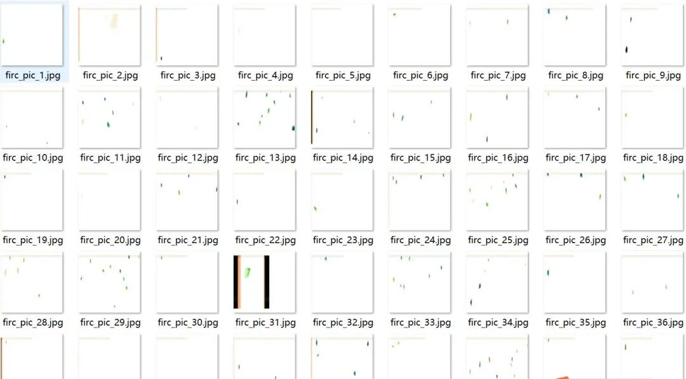
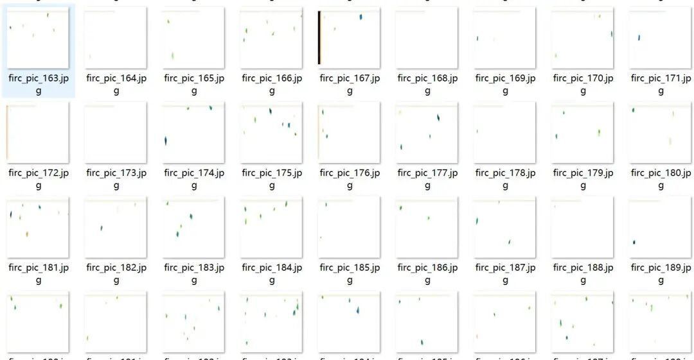
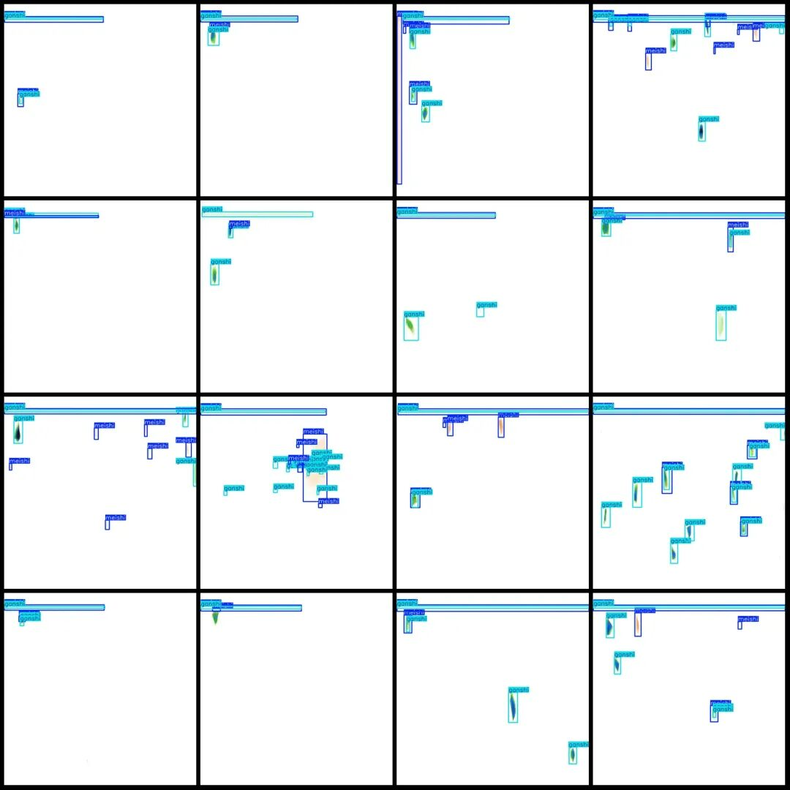
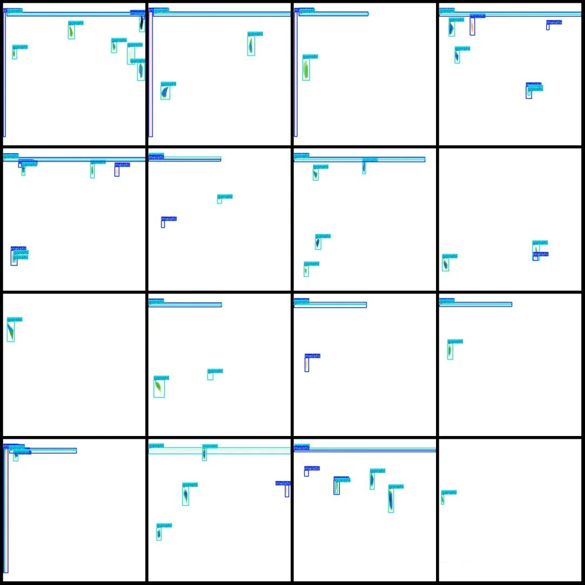
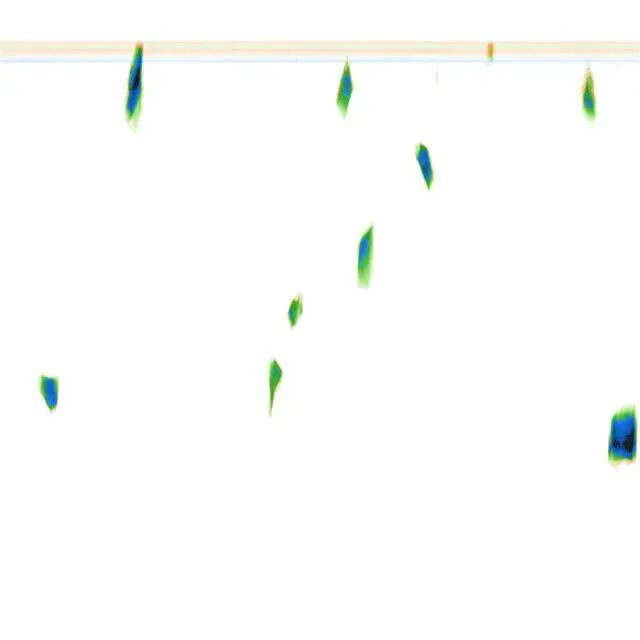

# Intelligent Industry X-ray Image Coal Gangue Detection Dataset VOC+YOLO format with 447 images in 3 categories

Dataset format: Pascal VOC format + YOLO format (txt file without split path, only containing jpg images and corresponding VOC format xml files and yolo format txt files)

Number of images (number of jpg files): 447

Number of annotations (number of xml files): 447

Number of annotations (number of txt files): 447

Label category count: 3

Label category names (Note that the order of categories in the YOLO format does not correspond to this, but is based on the labels folder's classes.txt): ["ganshi", "luansezawu", "meishi"]

Number of boxes labeled in each category:

Ganshi (Gan Shi) frame count = 1450

luansezawu (blue clutter) frame count = 2

Meishi (coal) Frames = 1045

Total frame count: 2497

Number of images per category:

Ganshi (Gangue) occupies a total of 437 images.

luansezawu (blue clutter) occupies = 2

Meishi (coal) has 397 images.

Image resolution: 640x640

Using labelImg:

Annotation rules: Draw a rectangle around the category.

Important Notice: The dataset does not have separate training, validation, and test sets; you need to partition them yourself.

Special : This dataset does not guarantee the accuracy of the trained models or weight files.

Image Preview:

Annotation example:

Original image:

## Payment

Here is a pay link on Stripe ( https://buy.stripe.com/3cs8yP7sY87d0vu9AB ). Please contact me lonlonago@foxmail.com after funding $89, and I will send you a complete data files , thank you!

